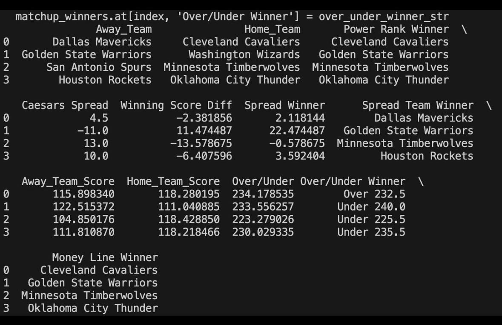
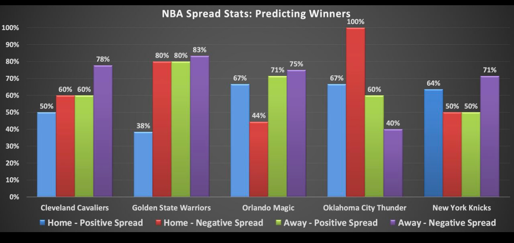
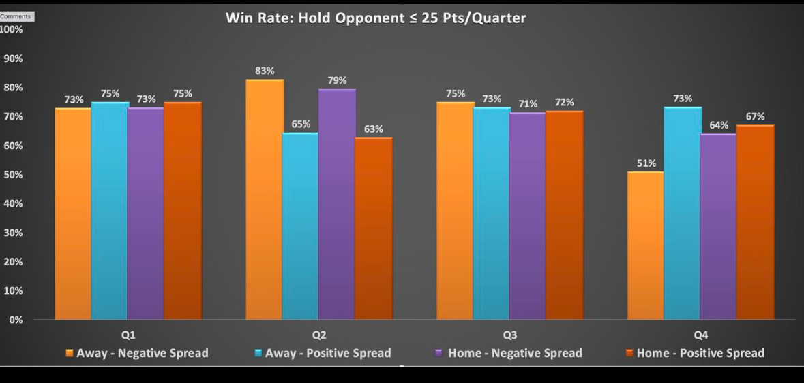

# 🏀 NBA Four Factor Modeling

Python-based NBA analytics project using **Dean Oliver's Four Factors**, matchup-adjusted statistics, weighted scoring formulas, and predictive modeling to evaluate NBA team strengths and predict game outcomes.

The project combines Python data collection, Excel modeling, rolling team statistics, matchup comparisons, and historical backtesting to explore which basketball performance metrics are most closely associated with winning.

**In Progress:** This is an ongoing personal project I'm actively improving in my free time with [@Yeswanth1649](https://github.com/Yeswanth1649). New metrics, modeling logic, and backtesting features are added regularly as I explore more ways to understand and predict NBA matchups.

---

## 🏀📚 Historical Foundation: Dean Oliver's Four Factors

This project draws inspiration from **Dean Oliver**, a pioneer of modern basketball analytics and author of *Basketball on Paper*.

Oliver identified four key factors that contribute to basketball success:

| Four Factor | Formula | Weight | What It Measures |
|---|---|---|---|
| **eFG%** | (FGM + 0.5 × 3PM) / FGA | 40% | Shooting efficiency |
| **TOV%** | TOV / (FGA + 0.44 × FTA + TOV) | 25% | Ball security |
| **ORB%** | ORB / (ORB + Opponent DRB) | 20% | Second-chance opportunities |
| **FTr** | FTM / FGA | 15% | Free throw scoring efficiency |

The **40/25/20/15 weighting framework** forms the foundation for comparing team efficiency and developing matchup-based predictive models.

The project evaluates these statistics from both offensive and defensive perspectives, including how teams perform against their opponents' strengths and weaknesses.

---

## 🎬 Interactive NBA Prediction Dashboard

### 🏀 Watch the Four Factors Prediction Model in Action

### [▶ OPEN THE ANIMATED NBA PREDICTION DASHBOARD](https://robcameron3.github.io/nba-four-factor-modeling/nba-prediction-showcase.html)

The interactive dashboard demonstrates how basketball performance statistics can be transformed into weighted team-strength scores and projected game winners.

**Dashboard features:**

- **Animated 5-on-5 basketball:** Illustrates three-point shooting, turnovers, steals, offensive rebounds, second-chance points, and free throws.
- **Moving Four Factors charts:** Compares shooting efficiency, turnover rates, offensive rebounding, and free throw rates across NBA matchups.
- **Weighted statistical formulas:** Demonstrates how the Four Factors can be normalized and combined into offensive and defensive strength ratings.
- **Team-strength comparisons:** Evaluates each team's relative efficiency and matchup advantages.
- **Winner predictions:** Illustrates how differences in team strength can be converted into a projected game winner and estimated win probability.

### How the Demonstration Model Calculates Team Strength

**Step 1 — Normalize the Four Factors**

Each statistic is compared against an NBA reference level to account for differences in statistical ranges.

**Step 2 — Calculate Weighted Strength**

```text
Offensive Strength =
    0.40 × Normalized eFG%
  + 0.25 × Normalized TOV% Advantage
  + 0.20 × Normalized ORB%
  + 0.15 × Normalized FTr
```

The same framework is applied to defensive performance, reversing the direction of the relevant opponent statistics.

**Step 3 — Calculate Overall Team Strength**

```text
Overall Team Strength =
    0.50 × Offensive Strength
  + 0.50 × Defensive Strength
```

**Step 4 — Compare Teams**

```text
Matchup Strength Differential =
    Team A Strength - Team B Strength
```

A positive differential favors Team A, while a negative differential favors Team B.

**Step 5 — Demonstrate Win Probability**

```text
P(Team A Wins) =
    1 / (1 + EXP(-1.4 × Strength Differential))
```

**Important:** The interactive dashboard currently uses realistic illustrative statistics and demonstration normalization and probability coefficients. These formulas explain a possible weighted Four Factors prediction workflow and should not be confused with the exact validated formulas or backtesting performance of the original Excel model.

---

## 📁 Files Included

| File Name | Description |
|---|---|
| `NBA_Player_Stats_2024_2025_Season.xlsx` | Auto-generated output from the Python script containing player and team statistics collected from Basketball Reference. |
| `NBA_Player_Stats.xlsx` | Excel modeling workbook containing weighted Four Factors, matchup-adjusted statistics, rolling performance metrics, and predictive calculations. |
| `NBA_Player_Stats.py` | Python scraper using `requests`, `BeautifulSoup`, and `pandas` to extract, clean, and export NBA statistics. |
| `nba-prediction-showcase.html` | Animated HTML dashboard illustrating Four Factors calculations, team-strength comparisons, and projected winners. |

---

## ⚙️ How It Works

### 1. Data Collection — Python

Run `NBA_Player_Stats.py` to collect NBA player and team statistics from Basketball Reference.

The script uses Python to extract, clean, organize, and export statistical data into Excel for further analysis.

### 2. Four Factors Modeling — Excel

The Excel model calculates offensive and defensive performance metrics using Dean Oliver's Four Factors.

Key calculations include:

- Effective field goal percentage (eFG%)
- Turnover percentage (TOV%)
- Offensive rebound percentage (ORB%)
- Free throw rate (FTr)
- Weighted offensive and defensive efficiency
- Opponent-adjusted performance
- Overall team-strength comparisons

### 3. Rolling Team Performance

Statistics are evaluated using multiple historical windows:

- Full-season performance
- Last 20 games
- Last 10 games
- Last 5 games

These rolling averages help identify changes in team efficiency, recent performance, and matchup advantages.

### 4. Matchup-Based Predictions

The model compares each team's offensive and defensive statistics, including opponent-adjusted performance.

Weighted scoring formulas and team-strength differentials are used to evaluate potential game winners and projected outcomes.

### 5. Historical Backtesting

Predictions are compared against actual game results to evaluate accuracy, identify patterns, and explore opportunities for improving the model.

---

## 📊 Three Major Areas of Analysis

### 1. 🏆 Predicting NBA Game Winners Using the Four Factors

**Objective:** Determine whether weighted offensive and defensive basketball statistics can help predict the winner of an NBA matchup.

The analysis evaluates:

- Shooting efficiency and three-point effectiveness
- Turnover rates and ball security
- Offensive rebounding and second-chance opportunities
- Free throw production
- Opponent-adjusted Four Factors
- Rolling season, 20-game, 10-game, and 5-game performance
- Weighted team-strength scores

The model compares team strengths, identifies a predicted winner, and evaluates that prediction against the actual result.

#### Matchup Prediction Output



---

### 2. 📈 Caesars Sportsbook Spread Prediction Analysis

**Objective:** Evaluate how model-generated spread selections perform against sportsbook point spreads and actual NBA game results.

This analysis separately examines the point spreads recorded from **Caesars Sportsbook at approximately 9:00 a.m.** on the day of each game.

The workflow includes:

1. Record the Caesars Sportsbook point spread at 9:00 a.m.
2. Evaluate the matchup using the project's statistical models.
3. Identify the model's projected spread selection.
4. Compare the selection with the actual final score and covering team.
5. Track spread prediction accuracy across historical games.

This analysis evaluates **against-the-spread predictions**, which are distinct from predicting the outright winner.

#### Spread Prediction Accuracy



---

### 3. 🛡️ Defensive Quarter Analysis — Holding Opponents to 25 or Fewer Points

**Objective:** Examine the relationship between defensive quarter performance and winning NBA games.

This analysis focuses on quarters in which a team holds its opponent to **25 points or fewer**.

The project explores how defensive performance across individual quarters relates to overall game outcomes.

Key questions include:

- How frequently do teams win when holding opponents to 25 or fewer points in a quarter?
- Does holding an opponent below this threshold in multiple quarters correspond to a higher game win rate?
- How does defensive consistency across four quarters relate to overall success?
- Can quarter-level defensive performance provide useful insight beyond full-game statistics?

The analysis investigates whether stronger defensive performances, particularly across multiple quarters, are associated with improved winning outcomes.

#### Defensive Quarter Win Rate



---

## 📌 Key Concepts & Analytical Techniques

- **Four Factors:** Weighted analysis of eFG%, TOV%, ORB%, and FTr.
- **Offensive & Defensive Efficiency:** Measuring team performance on both sides of the basketball.
- **Matchup Adjustments:** Comparing team statistics against opponent-allowed values and league averages.
- **Predictive Modeling:** Estimating game outcomes using statistical performance and team-strength differences.
- **Rolling Performance:** Evaluating season, last 20, last 10, and last 5 games.
- **Spread Analysis:** Comparing statistical selections against recorded Caesars Sportsbook point spreads.
- **Defensive Quarter Analysis:** Investigating the relationship between holding opponents to 25 or fewer points and winning.
- **Backtesting:** Comparing historical predictions with actual results to evaluate model performance.

---

## 🛠️ Technologies Used

| Technology | Application |
|---|---|
| Python | Data collection, processing, and automation |
| Pandas | Data cleaning and statistical organization |
| BeautifulSoup | Web scraping |
| Requests | Retrieving web data |
| Microsoft Excel | Statistical modeling, formulas, and backtesting |
| HTML / CSS / JavaScript | Animated basketball analytics dashboard |
| Basketball Reference | NBA statistical data source |
| Caesars Sportsbook | Recorded morning point-spread reference |

---

## 🚀 Ongoing Development

This project is continuously being improved through additional statistical metrics, matchup adjustments, modeling logic, and historical backtesting.

Future improvements may include:

- Expanding historical prediction evaluations
- Comparing different rolling statistical windows
- Refining matchup-adjusted scoring formulas
- Testing additional offensive and defensive indicators
- Connecting the animated dashboard directly to verified model outputs

---

**Project Goal:** Use basketball analytics, statistical modeling, and historical performance data to better understand NBA team strengths, predict game outcomes, evaluate spread selections, and identify the performance factors most strongly associated with winning.
